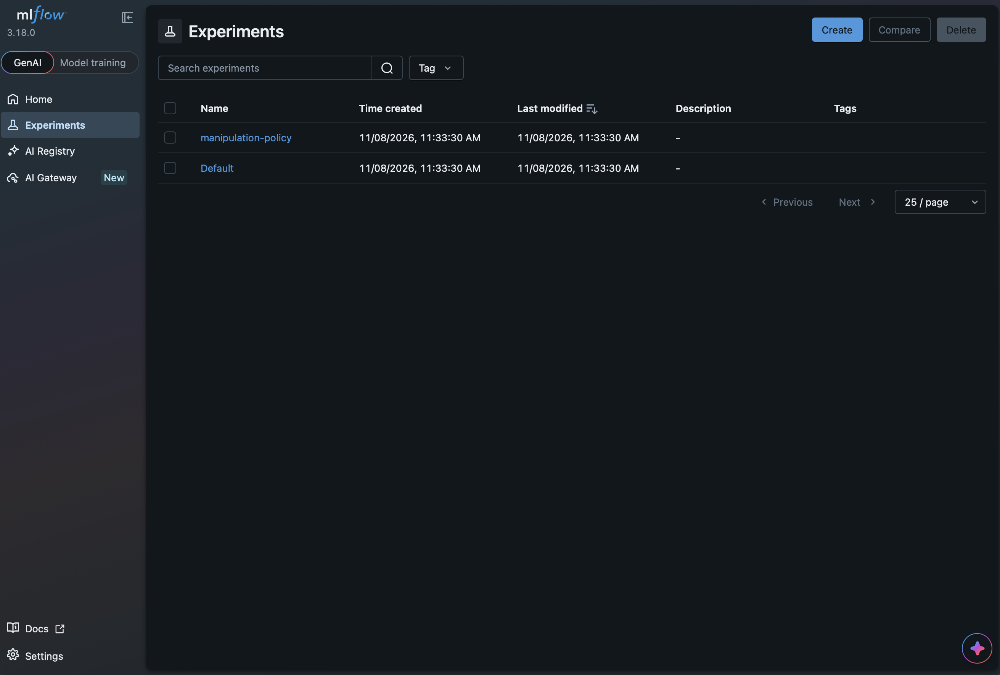
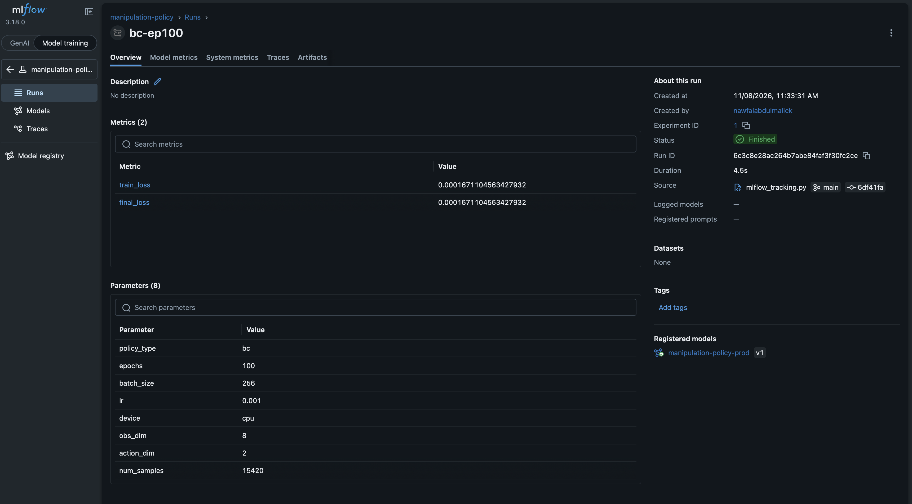
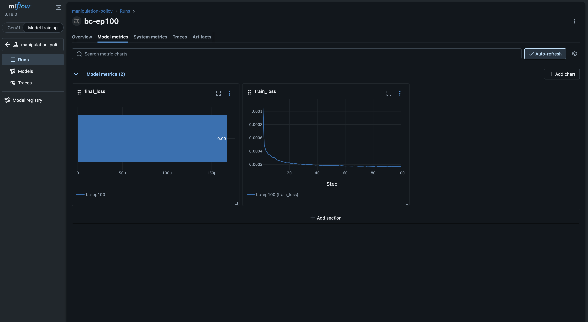
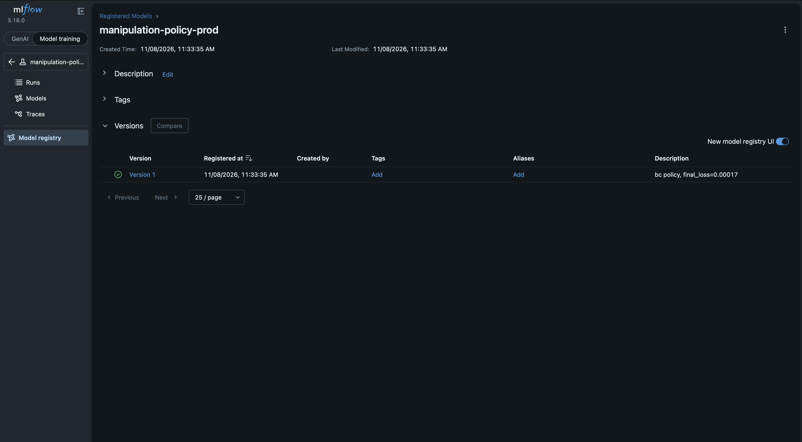
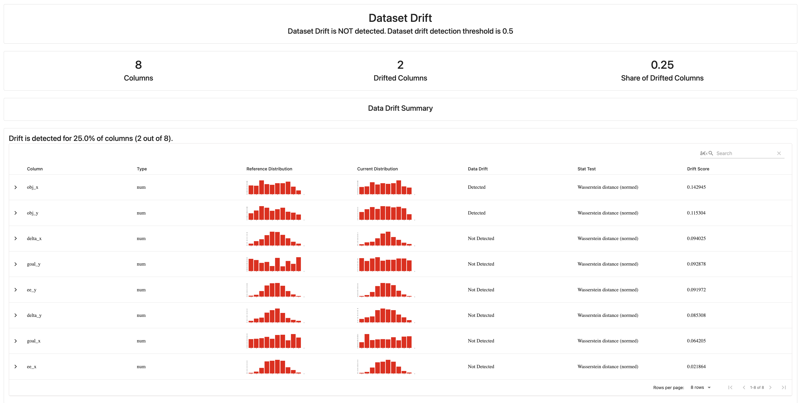

# 🤖 manipulation-policy-pipeline

**An end-to-end ML platform for robotics policy learning** — covering experiment tracking (MLflow), GPU inference optimisation (FP16 · torch.compile · ONNX), containerised serving (FastAPI + Docker), orchestration (Kubernetes), data drift monitoring (Evidently), observability (Prometheus · Grafana), CI/CD (GitHub Actions), and automated deployment (Ansible).

Trains a manipulation policy using Behavioural Cloning and Diffusion Policy, then wraps it in a production-grade shared platform that demonstrates the full ML lifecycle from training to live monitoring.

---

## ✨ What this demonstrates

| Capability | Technology |
|---|---|
| Policy training (BC + Diffusion) | PyTorch |
| **Experiment tracking + model registry** | **MLflow** |
| **GPU inference optimisation** | **FP16 · torch.compile · ONNX Runtime** |
| **Data drift monitoring** | **Evidently AI** |
| REST serving | FastAPI |
| Containerisation | Docker |
| Orchestration + auto-scaling | Kubernetes · HPA |
| Observability | Prometheus · Grafana |
| CI/CD | GitHub Actions |
| **Automated deployment** | **Ansible** |

---

## 🏗 Platform architecture

```
Training
└── BC Policy / Diffusion Policy (PyTorch)
    └── MLflow experiment tracking
        └── Model Registry (Staging → Production)

Serving
└── FastAPI inference server
    └── Docker image → Kubernetes Deployment
        ├── HPA (auto-scaling)
        └── Service (LoadBalancer)

Monitoring
├── Prometheus (metrics scrape)
├── Grafana (latency · throughput · error-rate dashboard)
└── Evidently (data drift detection → CI gate)

Deployment
└── Ansible playbook (Ubuntu 22.04 → full stack in one command)
```


---


## 📸 Screenshots

### MLflow Experiment Tracking


### MLflow Run — Loss Curve & Parameters


### MLflow Loss Curve


### Model Registry — Version 1 Registered


### Data Drift Report (Evidently)



---


## 🚀 Quick start

### 1. Train + track with MLflow
```bash
pip install -r requirements.txt
python generate_demos.py
python mlflow/mlflow_tracking.py --policy bc --data data/demos.npz
mlflow ui --port 5000
```

### 2. Promote best model to Production
```bash
python mlflow/model_registry.py best
python mlflow/model_registry.py list
```

### 3. Run GPU inference benchmark
```bash
python benchmarks/inference_benchmark.py --checkpoint checkpoints/bc_policy.pt
```
See [benchmarks/results.md](benchmarks/results.md) for FP16 / ONNX speedup numbers.

### 4. Run drift monitoring
```bash
python monitoring/drift/drift_monitor.py \
  --reference data/demos.npz \
  --production data/demos.npz \
  --output monitoring/drift/drift_report.html
```

### 5. Serve with Docker Compose (all services)
```bash
docker compose up --build
```

| Service | URL |
|---|---|
| Policy API | http://localhost:8000/docs |
| MLflow UI | http://localhost:5000 |
| Prometheus | http://localhost:9090 |
| Grafana | http://localhost:3000 |

### 6. Deploy to any Ubuntu server via Ansible
```bash
pip install ansible
ansible-galaxy collection install community.docker
ansible-playbook ansible/playbook.yml -i ansible/inventory.ini
```
See [ansible/README.md](ansible/README.md) for local Docker test instructions.

### 7. Kubernetes
```bash
kubectl apply -f k8s/
kubectl port-forward svc/grafana 3000:3000
```

---

## 🔧 Full stack

```
manipulation-policy-pipeline/
├── train_policy.py
├── models.py
├── serve.py
├── evaluate_policy.py
├── generate_demos.py
├── mlflow/
│   ├── mlflow_tracking.py       ← NEW: train + log to MLflow
│   └── model_registry.py        ← NEW: promote Staging → Production
├── benchmarks/
│   ├── inference_benchmark.py   ← NEW: FP16 / ONNX / torch.compile
│   └── results.md               ← NEW: benchmark results table
├── monitoring/
│   ├── prometheus.yml
│   ├── grafana_dashboard.json
│   └── drift/
│       └── drift_monitor.py     ← NEW: Evidently drift report + CI gate
├── ansible/
│   ├── playbook.yml             ← NEW: full-stack deployment
│   ├── inventory.ini
│   ├── inventory_local.ini
│   └── README.md
├── k8s/
├── .github/workflows/ci.yml
├── docker-compose.yml           ← UPDATED: added MLflow service
├── requirements.txt             ← UPDATED: mlflow, evidently, onnx
└── Dockerfile
```

---

## 📄 License
MIT
